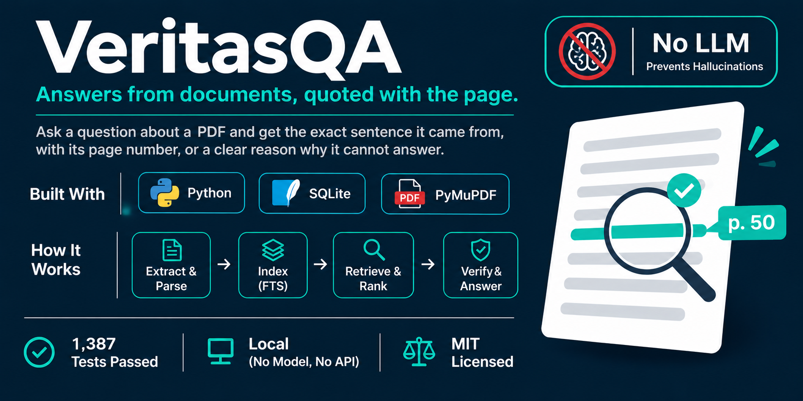
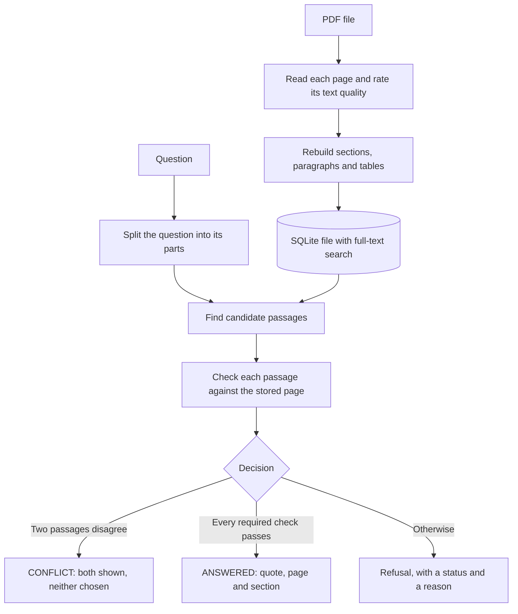

# VeritasQA



**Ask a question about a PDF and get a verbatim passage with its page number, or a reason the document could not support an answer.**

VeritasQA is a question-answering tool for documents such as policies, standards and manuals. It does not write answers of its own. Every answer is text copied word for word from the document, and when the evidence is not strong enough, it refuses and says why. It runs on your own computer: it needs no AI model, no API key and no internet connection to run.

Built with Python, SQLite and PyMuPDF. Licensed under MIT.

## Why it matters

Long documents are hard to check. Many chat tools write fluent answers, but a reader often cannot tell which words came from the source. VeritasQA works the other way round: each answer is a passage that is in the document, so a reviewer can confirm it in seconds on the page it names.

It suits teams that must point to the source of every answer, such as policy, compliance, procurement, legal and HR teams.

## What it does

- **Verbatim answers.** Each answer quotes the source, with its page and, where available, its section.
- **Clear refusals.** When the document does not support an answer, the result has a status and a reason, such as insufficient evidence, a conflict between passages, or a page whose text cannot be trusted.
- **Repeatable.** The same question on the same document gives the same output, so a result can be reproduced and audited.
- **Version comparison.** When a new version of a PDF is uploaded, its text is compared with the earlier version, page by page. The report lists the pages that changed, moved, were added or were removed, with the changed words.
- **Local.** The command line reads files on your computer. It needs no GPU, no model download and no account.

## See it work

A real result from the current code, on a public NIST document (SP 800-63B-4):

```text
Question:  How many meters is the range limit that was chosen based on the maximum
           expected range of a Bluetooth connection?
Status:    ANSWERED
Answer:    240 meters
Quote:     "3The limit of 240 meters was chosen based on the maximum expected range of a Bluetooth connection."
Page:      50
```

The leading "3" is probably a footnote marker from the source PDF. The answer is the sentence itself, so the reviewer reads the source, not a summary.

A question on a topic the document does not cover (NIST CSF 2.0) gets a refusal instead of a guess:

```text
Status:    INSUFFICIENT_EVIDENCE
Reason:    no retrieved sentence contains all of: document, explain, use, blockchain,
           distributed, ledger, technology, dlt, cybersecurity, risk, management
```

## How it works



1. **Read.** Each page is read and rated. On native-text pages with layout warnings, the structure pass checks whether individual passages are readable.
2. **Store.** The structure is kept in one SQLite file, with a full-text index and a stored copy of each page.
3. **Find and check.** Exact search and deterministic clause rules find candidate passages. The verifier checks each quote against the stored text and checks the question's numbers, subject, negation and conditions.
4. **Answer or refuse.** An answer is given only when every required check passes. Otherwise the result is a refusal, with its status and reason.

## Results

The evaluation covers 74 development questions across four public NIST documents (CSF 2.0, AI RMF 1.0, SP 800-63B-4 and SP 800-82r3) and uses rebuilt indexes.

| Outcome | Count |
| --- | ---: |
| Fully correct answer | 64 |
| Answer with incorrect wording or evidence | 0 |
| Refusal on an answerable question | 0 |
| Correct refusal | 10 |
| False acceptance | 0 |

The scorer compares exact text when a reference span is provided and checks cited evidence for passage-based questions. The assistant-drafted development questions guided the rules and were validated programmatically. The 23 held-out questions remain available for a future independent run.

The exact status matched 70 of 74 records. Four ambiguous questions received an insufficient-evidence refusal.

## Scope

- Rules cover common facts, locations, quantities, dates, permission wording, explicit procedures and some named tables.
- Coverage is best on PDF pages with native text. Pages whose text cannot be read are listed in the response warnings.
- Large changes in wording, ambiguous requests and answers that require combining several steps can still lead to refusals.

## Engineering

- **Design.** No model is in the answer path. Each stage has its own package, and each decision lists the checks that produced it. Decisions and their reasons are written down in `docs/ARCHITECTURE.md`.
- **Tests.** A regression suite checks past wrong answers, evidence integrity and refusals. The optional OCR test needs Tesseract.
- **Data safety.** The store checks each document before it writes, and it refuses a database whose schema version it does not know.
- **Dependencies.** Three runtime packages, pinned: PyMuPDF, pdfplumber and pydantic.

## Try it

Setup, the full command list, the Python interface and the test instructions are in [docs/TECHNICAL.md](docs/TECHNICAL.md).

```bash
python -m venv .venv
.venv/Scripts/python.exe -m pip install -r requirements.txt   # Windows; on macOS or Linux use .venv/bin/python
python -m app.api ingest my-document.pdf --store data/indexes/my-document.sqlite
python -m app.api ask --store data/indexes/my-document.sqlite --document-id DOCUMENT_ID "How many days is the limit for loans?"
```

`ingest` prints the `document_id` to use with `ask`. Each command prints one JSON object.

Run `ingest` again with the original PDF to refresh the source-unit quality and table labels in an existing store.

## Documents

- [docs/TECHNICAL.md](docs/TECHNICAL.md): setup, commands, the Python interface, limits and the tests
- [docs/ARCHITECTURE.md](docs/ARCHITECTURE.md): design, data contracts and limits
- [docs/SPEC.md](docs/SPEC.md): requirements and definition of done
- [docs/SETUP.md](docs/SETUP.md): the environment and its validation record

## Licence

The code is licensed under the MIT licence (see [LICENSE](LICENSE)). Anyone may use, copy, modify, publish and share it, provided the copyright notice stays with it.

The project uses PyMuPDF, which is licensed under AGPL-3.0 or sold under a commercial licence. The MIT licence does not change those terms. If you distribute a program that includes PyMuPDF, or offer one over a network, read the AGPL-3.0 terms or buy a commercial PyMuPDF licence. This is not legal advice.
