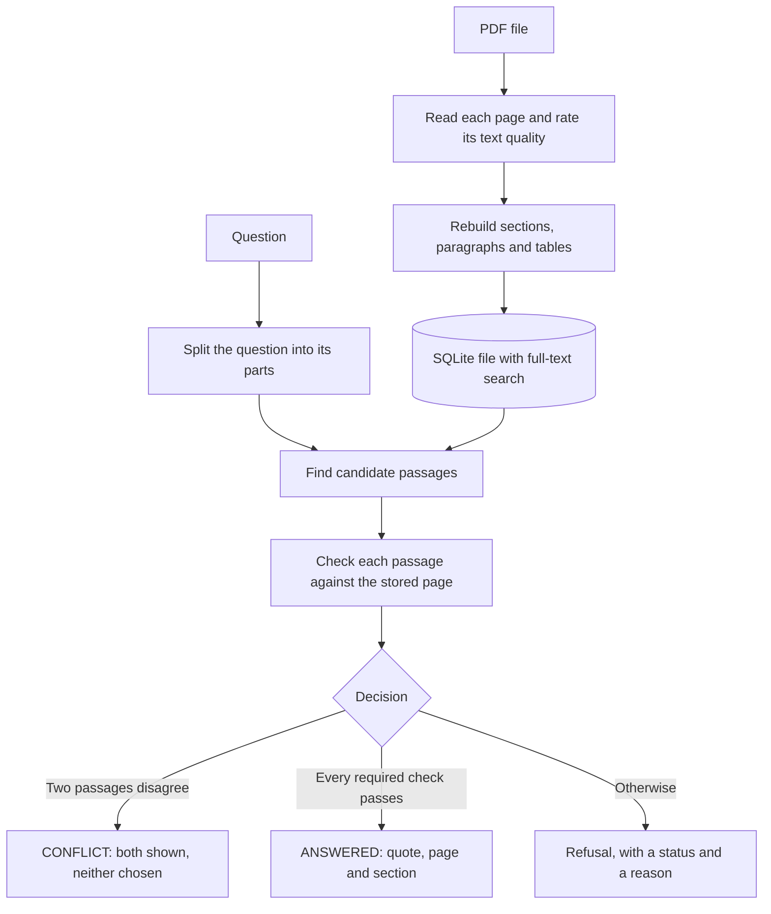

# VeritasQA

**Ask a question about a PDF and get the exact sentence it came from, with its page number, or a clear reason why it cannot answer.**

VeritasQA is a question-answering tool for documents such as policies, standards and manuals. It does not write answers of its own. Every answer is text copied word for word from the document, and when the evidence is not strong enough, it refuses and says why. It runs on your own computer: it needs no AI model, no API key and no internet connection to run.

Built with Python, SQLite and PyMuPDF. 1,387 automated tests passed in the latest full run. Licensed under MIT.

## Why it matters

Long documents are hard to check. Many chat tools write fluent answers, but a reader often cannot tell which words came from the source. VeritasQA works the other way round: each answer is a passage that is in the document, so a reviewer can confirm it in seconds on the page it names.

It suits teams that must point to the source of every answer, such as policy, compliance, procurement, legal and HR teams.

## What it does

- **Quotes, not paraphrases.** Each answer is the exact sentence, with its page and, where the document has one, its section.
- **Clear refusals.** When the document does not support an answer, the result has a status and a reason, such as insufficient evidence, a conflict between passages, or a page whose text cannot be trusted.
- **Repeatable.** The same question on the same document gives the same output, so a result can be reproduced and audited.
- **Version comparison.** When a new version of a PDF is uploaded, its text is compared with the earlier version, page by page. The report lists the pages that changed, moved, were added or were removed, with the changed words.
- **Local.** The command line reads files on your computer. It needs no GPU, no model download and no account.

## See it work

A real result from the current code, on a public NIST document (SP 800-63B-4):

```text
Question:  How many meters is the range limit that was chosen based on the maximum
           expected range of a Bluetooth connection?
Status:    ANSWERED
Answer:    240 meters
Quote:     "3The limit of 240 meters was chosen based on the maximum expected range of a Bluetooth connection."
Page:      50
```

The leading "3" is probably a footnote marker from the source PDF. The answer is the sentence itself, so the reviewer reads the source, not a summary.

A question on a topic the document does not cover (NIST CSF 2.0) gets a refusal instead of a guess:

```text
Status:    INSUFFICIENT_EVIDENCE
Reason:    no retrieved sentence contains all of: document, explain, use, blockchain,
           distributed, ledger, technology, dlt, cybersecurity, risk, management
```

## How it works



1. **Read.** Each page is read and rated. A page whose text cannot be trusted is flagged, and nothing on it is accepted as evidence.
2. **Store.** The structure is kept in one SQLite file, with a full-text index and a stored copy of each page.
3. **Find and check.** The best matching passages are ranked. Each one is checked against the stored page: the words must match exactly, and the numbers, subject, negation and conditions must agree.
4. **Answer or refuse.** An answer is given only when every required check passes. Otherwise the result is a refusal, with its status and reason.

## Results

Measured with default settings, in one development pass with no tuning. The figures are copied from the project's recorded runs.

**74 development questions from four public NIST documents** (CSF 2.0, AI RMF 1.0, SP 800-63B-4 and SP 800-82r3)

| Outcome | Count |
| --- | --- |
| Answered, and fully correct | 1 |
| Answered, with the right passage, but the wording did not match the expected text | 2 |
| Refused, although the document answers the question | 61 |
| Refused, correctly, because the document does not answer the question | 10 |
| Answered, although the document does not answer the question (a false acceptance) | 0 |

Answers are scored by exact text, so a correct fact in different words counts as wrong. That is a deliberate choice. The questions were written by an assistant and checked by a program; no person has checked them by hand. The 23 held-out questions for these documents have not been run.

**One private document, not published here.** Its retrieval settings were tried on 32 development questions, and no setting produced an answer, so the defaults were kept. Its 14 held-out questions were then run once. The system made no wrong answer. It correctly refused the one question the document does not answer, and it refused the 13 it should have answered.

**Six development sets, 187 questions in total.** One correct answer, two answers with the wrong wording at the edges, and no false acceptance.

The main limit is coverage: the system refuses most answerable questions, because it answers only when the evidence can be checked. Answering more questions without adding wrong answers is the next piece of work.

## What it does not do

- It does not summarise or paraphrase. Every answer is taken word for word from the document.
- It answers only some kinds of question: numbers with units, percentages, money amounts, dates and periods, and permission or prohibition wording. Other questions return the matching passages.
- It does not read text inside images or scanned pages. Those pages are not used as evidence.
- It matches words, so a question worded very differently from the document is often refused.

## Engineering

- **Design.** No model is in the answer path. Each stage has its own package, and each decision lists the checks that produced it. Decisions and their reasons are written down in `docs/ARCHITECTURE.md`.
- **Tests.** 1,387 automated tests passed in the latest full run. One test is skipped, because it needs the optional OCR program. A regression suite holds past wrong answers, so they are tested again on every change.
- **Data safety.** The store checks each document before it writes, and it refuses a database whose schema version it does not know.
- **Dependencies.** Three runtime packages, pinned: PyMuPDF, pdfplumber and pydantic.

## Try it

Setup, the full command list, the Python interface and the test instructions are in [docs/TECHNICAL.md](docs/TECHNICAL.md).

```bash
python -m venv .venv
.venv/Scripts/python.exe -m pip install -r requirements.txt   # Windows; on macOS or Linux use .venv/bin/python
python -m app.api ingest my-document.pdf --store data/indexes/my-document.sqlite
python -m app.api ask --store data/indexes/my-document.sqlite --document-id DOCUMENT_ID "How many days is the limit for loans?"
```

`ingest` prints the `document_id` to use with `ask`. Each command prints one JSON object.

## Documents

- [docs/TECHNICAL.md](docs/TECHNICAL.md): setup, commands, the Python interface, limits and the tests
- [docs/ARCHITECTURE.md](docs/ARCHITECTURE.md): design, data contracts and limits
- [docs/SPEC.md](docs/SPEC.md): requirements and definition of done
- [docs/SETUP.md](docs/SETUP.md): the environment and its validation record

## Licence

The code is licensed under the MIT licence (see [LICENSE](LICENSE)). Anyone may use, copy, modify, publish and share it, provided the copyright notice stays with it.

The project uses PyMuPDF, which is licensed under AGPL-3.0 or sold under a commercial licence. The MIT licence does not change those terms. If you distribute a program that includes PyMuPDF, or offer one over a network, read the AGPL-3.0 terms or buy a commercial PyMuPDF licence. This is not legal advice.
