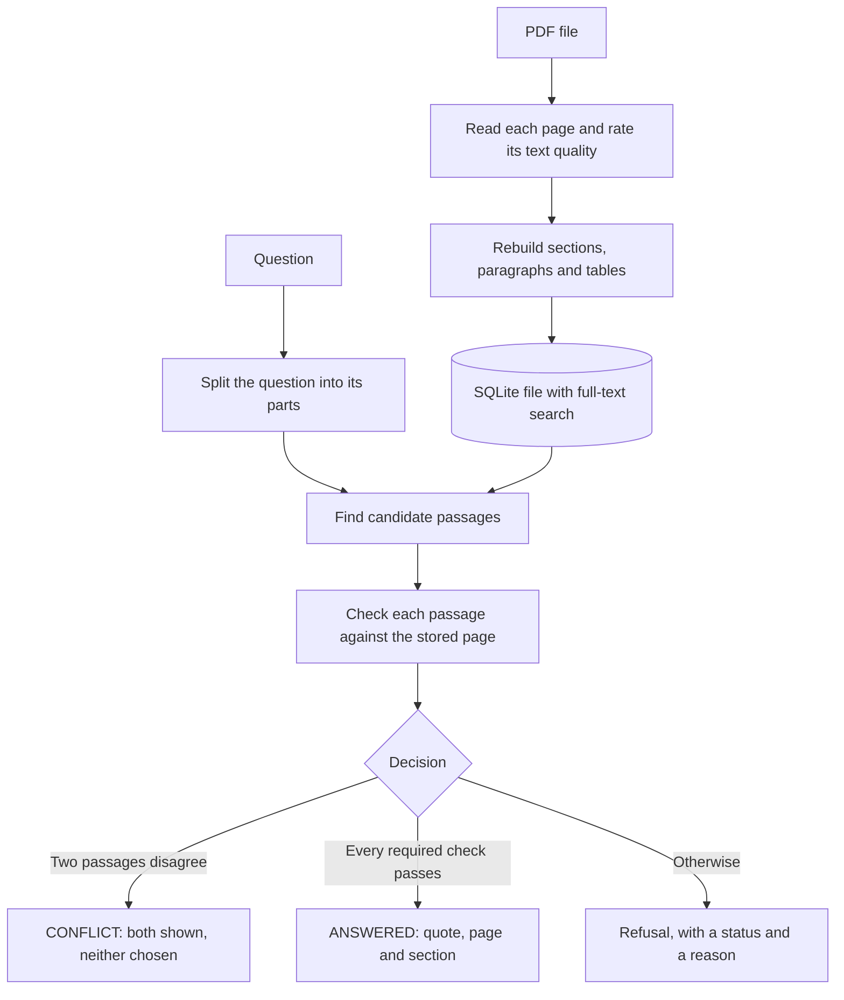
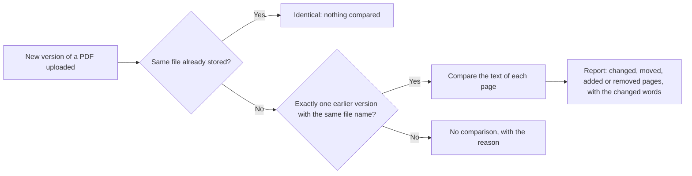

# How VeritasQA works: flowchart brief

This page has two diagrams and an image brief. The first diagram is the same as in the README. The Mermaid blocks render on GitHub, so the diagrams stay in step with the code's steps. The image brief at the end builds a picture from the same labels.

## 1. Answering a question



## 2. Uploading a new version of a document



## Image brief

Paste this into an image generator to make a picture of the first diagram. Save the result as `docs/images/flowchart.png`. The Mermaid diagram stays the live version, and the picture is optional.

```text
Create a clean, flat flowchart infographic, 16:9 landscape, on a plain deep navy background (#0B1F33).
Read it from left to right. Use rounded white boxes with thin teal (#14B8A6) outlines, thin light arrows, and a diamond for the decision. Fill the ANSWERED box with teal. Use amber (#F59E0B) outlines for the refusal box.

Top row, left to right, boxes labelled exactly:
"PDF file" -> "Read each page and rate its text quality" -> "Rebuild sections, paragraphs and tables" -> a database cylinder labelled "SQLite file with full-text search".

Bottom row, left to right, starting from a box labelled "Question":
"Question" -> "Split the question into its parts" -> "Find candidate passages" (the database cylinder feeds into this box) -> "Check each passage against the stored page" -> a diamond labelled "Decision", with three exits:
- "Two passages disagree" -> "CONFLICT: both shown, neither chosen"
- "Every required check passes" -> "ANSWERED: quote, page and section"
- "Otherwise" -> "Refusal, with a status and a reason"

Text rule: spell every label exactly as written, and keep the labels short. Add no other text, numbers, percentages, logos, brand marks, or the word "AI".
```

## Checks before you use it

- Every label matches the Mermaid diagram above, with the same spelling.
- No score, percentage, logo or claim that is not in the diagram. The project uses no AI model, so the picture must not suggest one.
- Only the decision diamond has three exits. The other boxes have one arrow in and one out.
